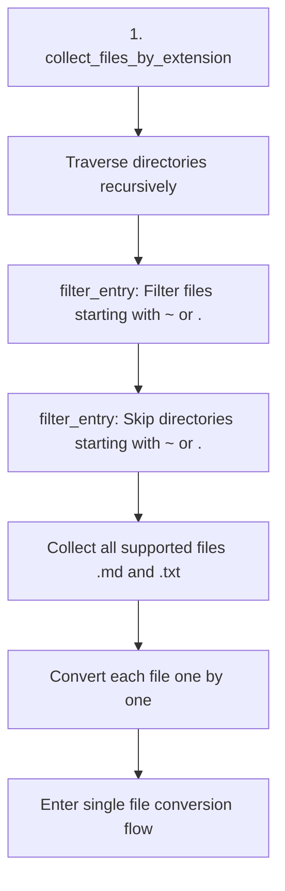
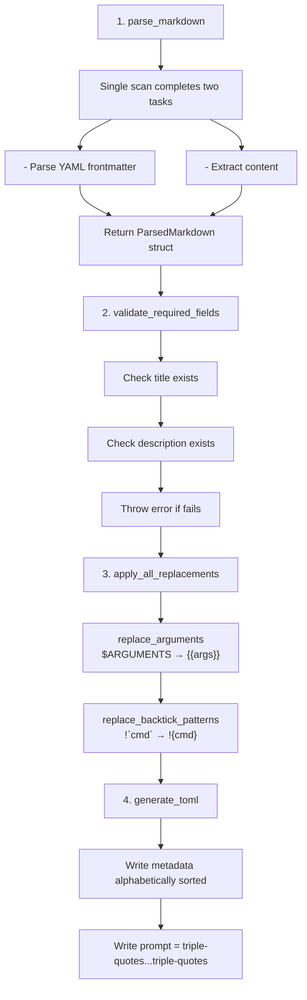

# md2toml Conversion Rules


## File Processing Rules
### Rule 1: File and Directory Filtering

Filtering rules are applied first when traversing directories.

- Ignore Rules:
  - Files starting with `~` or `.` are ignored (applies to all supported file types)
  - Directories starting with `~` or `.` are ignored entirely (including all files within)
- Purpose:
  - Tilde symbol (`~`): Allows users to mark temporary files or drafts (e.g., `~draft.md`, `~backup.md`)
  - Dot symbol (`.`): Skips hidden files and system directories (e.g., `.DS_Store`, `.git`, `.claude`)
- Performance Considerations:
  - Uses `walkdir`'s `filter_entry` to filter during traversal, avoiding unnecessary reads
  - Filters both files and directories for optimal efficiency
- Examples:
  - ✅ Will process: `normal.md`, `docs/guide.md`, `notes.txt`, `file~with~tilde.md`, `file.with.dots.md`
  - ❌ Will ignore: `~temp.md`, `.hidden.txt`, `~backup/readme.md`, `.git/config.md`, `docs/~old/guide.md`


## Single File Conversion Rules
### Rule 2: YAML Frontmatter Parsing

Parses the metadata block of files.

- Input: YAML format metadata between `---` delimiters
- Output: `BTreeMap<String, String>` (automatically sorted alphabetically)
- Special Handling:
  - Numbers are automatically converted to strings (`42` → `"42"`)
  - Booleans are automatically converted to strings (`true` → `"true"`)
  - Sequences (arrays) are converted to flow-style format (`[rust, cli, tool]`)
  - Mappings (objects) are converted to flow-style format (`{key: value, key2: value2}`)
  - Nested structures are supported (`[[a, b], [c, d]]`, `{config: {verbose: true}}`)
- Format Details:
  - Flow-style is human-readable without JSON escaping (e.g., `[rust, cli]` not `["rust","cli"]`)
  - Strings with special characters are automatically quoted (`"hello, world"`)
  - All values are stored as single-line strings for TOML compatibility

### Rule 1.5: Supported File Types and Processing Strategies

This tool supports two file types with different processing strategies:

| File Type | Output Type | Strategy | Description |
|-----------|-------------|----------|-------------|
| `.md` | `.toml` | Convert | Parse frontmatter, replace special syntax, generate TOML |
| `.txt` | `.txt` | Copy | Direct copy without any conversion |

Processing Strategy Implementation:
```rust
enum ProcessingStrategy {
    Convert,  // md → toml (full conversion pipeline)
    Copy,     // txt → txt (direct copy)
}
```

Examples:
- ✅ `guide.md` → Converted to `guide.toml`
- ✅ `notes.txt` → Copied to `notes.txt`
- ❌ `data.json` → Not supported, will be ignored


### Rule 3: Required Field Validation

Validates whether a file is a valid cc slash command file.

- Required Fields: `title` and `description` (case-sensitive)
- Error Message: `"This is not a markdown file for cc slash command."`
- Purpose: Ensures the file is specifically for cc slash command usage

### Rule 4: Content Extraction

Extracts all content after the frontmatter.

- Input: All content after the second `---` delimiter
- Preserves:
  - All newlines (except the last one)
  - All indentation
  - All blank lines
  - All special characters


## Content Replacement Rules
### Rule 5: $ARGUMENTS Replacement

Replaces specific parameter placeholders.

- Input: `$ARGUMENTS` (case-sensitive)
- Output: `{{args}}`
- Supports: Multiple occurrences, multi-line content

### Rule 6: Backtick Pattern Replacement

Replaces command patterns.

- Input: `` !`command` ``
- Output: `!{command}`
- Regular Expression: `!`([^`]\*)``
- Performance Optimization: Uses `once_cell` for static compilation, avoiding recompilation on each call


## Output Generation Rules
### Rule 7: TOML Generation

Generates the final TOML format output.

- Metadata:
  - Format: `key ="value"`
  - Order: Alphabetically sorted (BTreeMap handles automatically)
  - Special Characters: Double quotes must be escaped (`"` → `\"`)

- Content:
  - Format: `prompt ="""..."""` (multi-line string)
  - Preserves all formatting


## Execution Order
### Directory Conversion Flow



### Single File Conversion Flow



### Detailed Step Descriptions
#### Directory: Collect Files (Directory Traversal)

```rust
let md_files = collect_files_by_extension(src_dir, "md")?;
let txt_files = collect_files_by_extension(src_dir, "txt")?;
```

**Key Features**:

- Uses `filter_entry` to filter during traversal phase, improving performance
- Skips entire directories starting with `~` or `.`, avoiding unnecessary recursion

#### Step 1: Parse

```rust
// Optimized version: Single scan completes two tasks
let ParsedMarkdown { metadata, content } = parse_markdown(input)?;

// Backward compatible: Separate calls
let metadata = parse_frontmatter(input)?;
let content = extract_content(input)?;
```

**Key Optimization**: Only scans for `---` delimiter once, avoiding redundant traversal.

#### Step 2: Validate

```rust
validate_required_fields(&metadata)?;
```

**Purpose**: Ensures the file contains `title` and `description` fields.

#### Step 3: Replace

```rust
// Chained invocation (internal order is fixed)
let processed = apply_all_replacements(content);

// Equivalent to
let step1 = replace_arguments(content);         // $ARGUMENTS → {{args}}
let step2 = replace_backtick_patterns(&step1);  // !`cmd` → !{cmd}
```

**Execution Order**: Process `$ARGUMENTS` first, then backtick patterns.

#### Step 4: Generate

```rust
let toml_output = generate_toml(&metadata, &processed_content)?;
```

**Output Format**:

```toml
key1 = "value1"
key2 = "value2"

prompt = """
content here
with replacements
"""
```


## Complete Example
### Input (example.md)

```markdown
---
title: Git Status Command
description: Show git repository status
author: DevTeam
version: 2.0
---

Please check $ARGUMENTS in the repository.

Use !`git status` to see changes.
Then use !`git diff` for details.
```

### Processing Flow

1. Parse:
   - metadata = { "author": "DevTeam", "description": "Show...", "title": "Git...", "version": "2.0" }
   - content = "Please check $ARGUMENTS...\n\nUse !`git status`..."

2. Validate:
   - ✅ title exists
   - ✅ description exists
   - Passes validation

3. Replace:
   - `$ARGUMENTS` → `{{args}}`
   - `` !`git status` `` → `!{git status}`
   - `` !`git diff` `` → `!{git diff}`

4. Generate:

   ```toml
   author = "DevTeam"
   description = "Show git repository status"
   title = "Git Status Command"
   version = "2.0"

   prompt = """
   Please check {{args}} in the repository.

   Use !{git status} to see changes.
   Then use !{git diff} for details.
   """
   ```


## Error Handling Example
### Missing Required Fields

```markdown
---
title: Example
author: User
---

Content
```

**Error**:

```
Error: Invalid frontmatter format: This is not a markdown file for cc slash command.
```

**Reason**: Missing `description` field.


## Test Coverage
### Unit Tests (65 tests)

- Parser: 12 tests (metadata + content + validation)
- Replacer: 14 tests ($ARGUMENTS + backticks)
- Generator: 9 tests (TOML output)
- Error: 5 tests (validation failures)
- Directory: 16 tests (path detection + file collection + prefix filtering)
  - 8 prefix filtering tests:
    - ✅ Ignore files starting with `~`
    - ✅ Ignore files starting with `.`
    - ✅ Do not ignore normal files (including filenames with symbols in the middle)
    - ✅ Ignore directories starting with `~`
    - ✅ Ignore directories starting with `.`
    - ✅ Do not ignore normal directories
    - ✅ `collect_files_by_extension` ignores tilde and dot files
    - ✅ `collect_files_by_extension` ignores tilde and dot directories

### Integration Tests (18 tests)

- Directory conversion tests (8 tests):
  - ✅ Nested directory structure conversion
  - ✅ Validation failure handling
  - ✅ Empty directory error handling
  - ✅ Partial success scenarios
  - ✅ Deep nesting support
  - ✅ Path mapping correctness
  - ✅ Special character filenames
  - ✅ Prefix filtering (~ and .)
- File conversion tests (10 tests):
  - 6 basic conversion tests (without required field validation)
  - 4 validation tests:
    - ✅ Pass validation (has title + description)
    - ❌ Missing description
    - ❌ Missing title
    - ❌ No metadata
